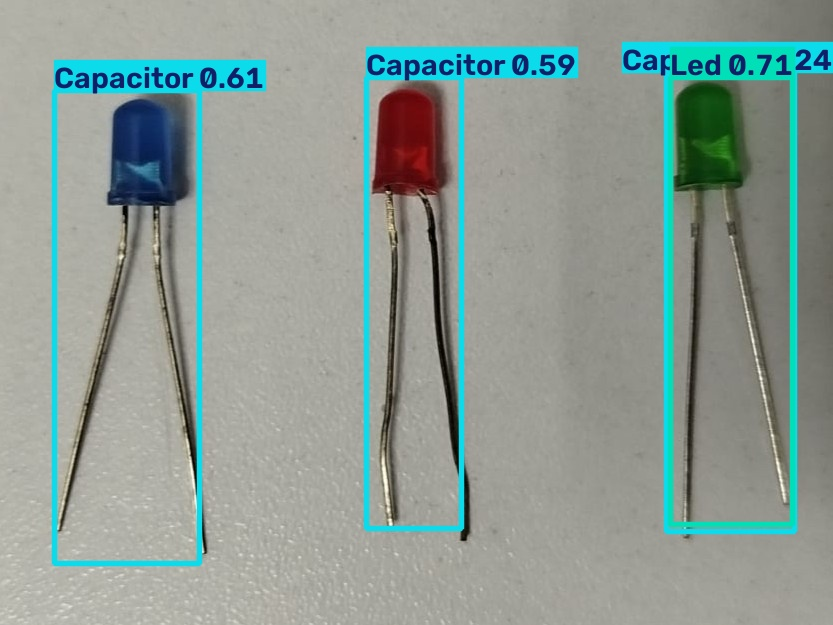
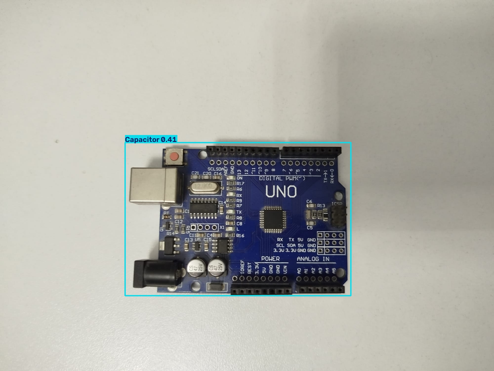
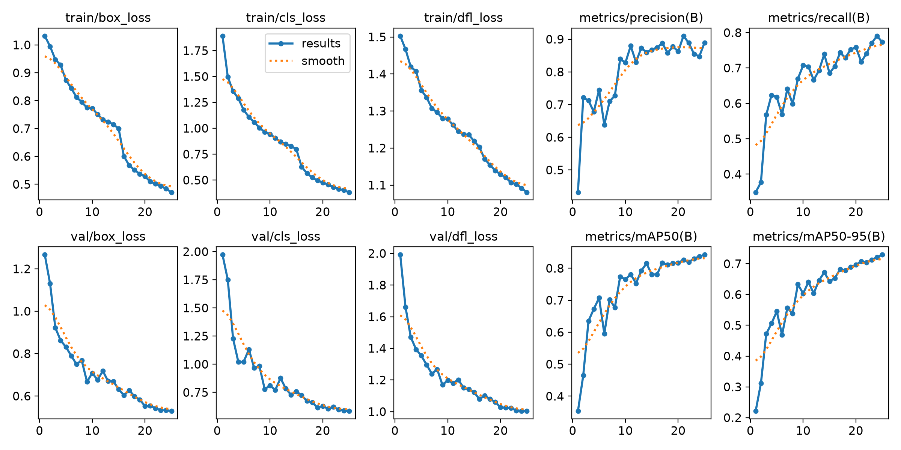
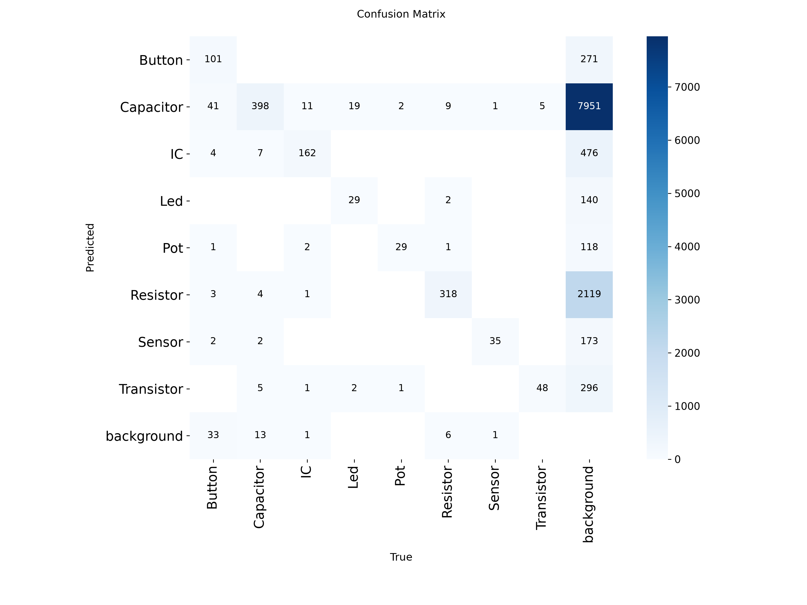

# Derin Öğrenme ve YOLOv8 Tabanlı Elektronik Devre Bileşenleri ve Komponent Tespiti Sistemi

Bu proje; bilgisayarlı görü (Computer Vision) ve modern nesne tespiti mimarilerini kullanarak, basılı devre kartları (PCB), prototip devreler ve elektronik bileşenler üzerindeki temel devre elemanlarını otomatik olarak tespit etmek, sınır kutuları (bounding box) ile konumlandırmak ve gerçek zamanlı sınıflandırmak amacıyla geliştirilmiş uçtan uca bir yapay zekâ mühendisliği çalışmasıdır.

Sistem, Roboflow Universe üzerindeki 9.800'den fazla devre görseliyle optimize edilmiş **YOLOv8** derin öğrenme omurgasını temel alır. Eğitilen model; dirençler, kondansatörler, entegre devreler (IC), LED'ler, butonlar, potansiyometreler, transistörler ve harici modül sensörleri dahil olmak üzere 8 farklı kritik bileşen sınıfını mikrosaniye seviyelerinde tespit edebilmektedir. 

Eğitilen model yalnızca akademik metriklerle sınırlı kalmamış; kullanıcıların herhangi bir devre görselini kolayca yükleyip sonuçları canlı olarak inceleyebileceği, güven eşiklerini (confidence threshold) dinamik olarak ayarlayabileceği ve komponent yoğunluğunu analiz edebileceği modern ve hafif bir **FastAPI** web uygulaması olarak kullanıma sunulmuştur. Ayrıca sistem, Arduino eğitim setinde yer alan fiziksel komponentlerin akıllı telefon kameralarıyla çekilen gerçek fotoğrafları üzerinde test edilerek pratik dünya dayanıklılığı ve alan kayması (domain shift) analiziyle doğrulanmıştır.

---

## Öne Çıkan Özellikler

- **8 Farklı Komponent Sınıfı:** `Button`, `Capacitor`, `IC`, `Led`, `Pot`, `Resistor`, `Sensor`, `Transistor`
- **Yüksek Doğruluk:** Bağımsız test setinde **%91.48 mAP@50** genel başarı oranı.
- **Yüksek Çıkarım Hızı:** Görsel başına yalnızca **~3.9 milisaniye** (~256 FPS) çalışma hızı.
- **Modern Web Arayüzü:** FastAPI tabanlı, sürükle-bırak destekli, anlık görselleştiren web paneli.
- **Gerçek Dünya Doğrulaması:** Arduino başlangıç setindeki gerçek devre elemanlarıyla test edilmiş ve doğrulanmıştır.

---

## Gerçek Dünya Test Sonuçları

Model, akıllı telefon kamerasıyla doğal oda ışığında ve ahşap masa üzerinde çekilen gerçek devre parçalarıyla test edilmiştir.

### Ultrasonik Sensör Tespiti (HC-SR04)

Tespit edilen sınıf: **Sensor** (Güven Skoru: %95)

### LED Bileşenleri Tespiti

Tespit edilen sınıf: **Led** (Güven Skoru: %71)

### Buton Bileşenleri Tespiti

Tespit edilen sınıf: **Button** (Güven Skoru: %64, %33)

### Direnç Bileşenleri Tespiti

Tespit edilen sınıf: **Resistor** (Güven Skoru: %10)

### Arduino Uno Kart Tespiti

Kart üzerindeki SMD blokları kondansatör olarak algılanmıştır.

---

## Model Eğitimi ve Performans Grafikleri

Model, Roboflow üzerindeki 9.800+ görselden oluşan elektronik bileşenler veri seti üzerinde NVIDIA RTX GPU desteğiyle 25 epoch eğitilmiştir.

### Eğitim Kayıp (Loss) ve Başarı Eğrileri


### Hata Matrisi (Confusion Matrix)


### Sınıf Bazlı mAP@50 Başarı Skorları:
- **Sensor:** %99.5
- **Transistor:** %97.5
- **Pot (Potansiyometre):** %96.8
- **Resistor (Direnç):** %96.7
- **IC (Entegre):** %92.7
- **Button (Buton):** %90.7
- **Capacitor (Kondansatör):** %80.1
- **Led:** %77.7

---

## Hızlı Başlangıç (Nasıl Çalıştırılır?)

### 1. Gereksinimleri Yükleyin
Python 3.10+ kurulu olduğundan emin olun. Gerekli kütüphaneleri yüklemek için:
```bash
pip install ultralytics fastapi uvicorn python-multipart
```

### 2. Web Uygulamasını Başlatın
Arayüzü ayağa kaldırmak için aşağıdaki komutu çalıştırın:
```bash
python app_fastapi.py
```

### 3. Tarayıcınızda Açın
Tarayıcınızı açıp aşağıdaki adrese gidin:
```
http://localhost:8000
```
- Bilgisayarınızdan istediğiniz devre fotoğrafını yükleyebilir veya hazır test butonlarına tıklayabilirsiniz.
- Anlık olarak komponentlerin yerini, güven skorlarını ve milisaniye cinsinden tespit süresini görebilirsiniz.

---

## Kullanılan Teknolojiler

- **Model:** YOLOv8 Nano (`ultralytics`)
- **Derin Öğrenme Altyapısı:** PyTorch (CUDA 12.4 GPU Hızlandırması)
- **Web Backend & Sunucu:** FastAPI & Uvicorn
- **Veri Seti:** Roboflow Universe - Electronic Components Dataset
- **Raporlama:** Python-docx & docx2pdf

---

## Proje Dizin Yapısı

```
ElectronicComponentsRecognition/
├── assets/                     # README görselleri ve test fotoğrafları
├── real_images/                # Telefonla çekilen orijinal test fotoğrafları
├── real_results_annotated/     # Modelin tespit kutularını çizdiği fotoğraflar
├── app_fastapi.py              # Web uygulaması (FastAPI)
├── train.py                    # YOLOv8 eğitim betiği
├── evaluate.py                 # Test seti performans değerlendirme betiği
├── build_report.py             # Word ve PDF rapor oluşturucu
├── PROJE_RAPORU.pdf            # Resmi proje raporu (PDF)
├── PROJE_RAPORU.docx           # Resmi proje raporu (Word)
└── README.md                   # Proje tanıtım dokümanı
```

---
