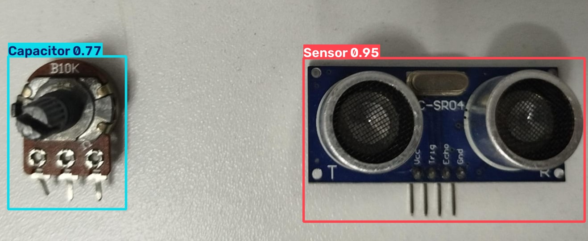
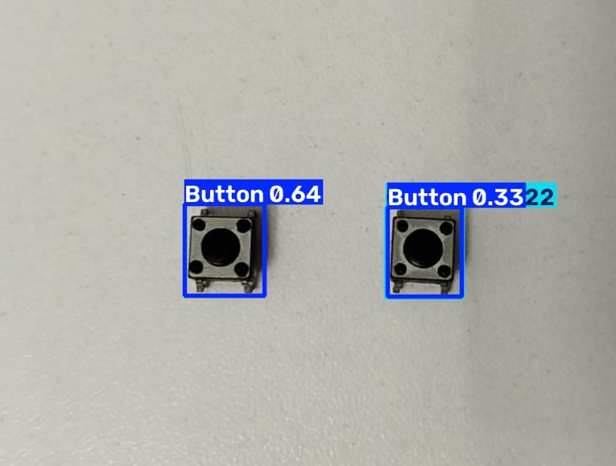
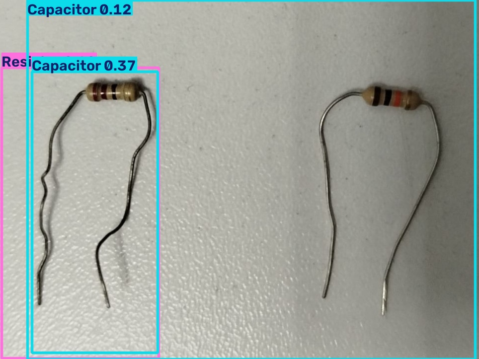

# YOLOv8 ile Elektronik Devre Elemanları ve Komponent Tespiti

Bu proje, elektronik devre kartları üzerindeki bileşenleri (direnç, kondansatör, LED, buton, transistör, entegre, sensör vb.) derin öğrenme ve bilgisayarlı görü yöntemleriyle otomatik olarak tespit edip sınıflandırmak amacıyla geliştirilmiştir.

Model olarak nesne tespiti alanında hafif, hızlı ve yüksek doğruluğa sahip **YOLOv8 Nano** kullanılmış, Roboflow üzerindeki 9.800'den fazla devre fotoğrafıyla eğitilmiştir. Eğitilen model 8 farklı komponent sınıfını yüksek doğrulukla kutu içine alıp etiketleyebilmektedir.

Kullanıcıların devre fotoğraflarını tarayıcıdan kolayca yükleyip sonuçları görebilmesi için sistem **FastAPI** ile çalışan bir web uygulaması hâline getirilmiştir. Ayrıca model, Arduino başlangıç setindeki gerçek parçaların telefonla çekilen fotoğraflarıyla test edilmiş ve gerçek ortam performansı değerlendirilmiştir.

---

## Öne Çıkan Özellikler

- **8 Farklı Komponent Sınıfı:** `Button`, `Capacitor`, `IC`, `Led`, `Pot`, `Resistor`, `Sensor`, `Transistor`
- **Yüksek Doğruluk:** Bağımsız test setinde **%91.48 mAP@50** genel başarı oranı.
- **Hızlı Tahmin Süresi:** Görsel başına yalnızca **~3.9 milisaniye** (~256 FPS) çalışma hızı.
- **Modern Web Arayüzü:** FastAPI tabanlı, sürükle-bırak destekli, anlık görselleştiren web paneli.
- **Gerçek Ortam Testleri:** Arduino setindeki gerçek devre elemanlarıyla test edilmiş ve doğrulanmıştır.

---

## Gerçek Dünya Test Sonuçları

Model, akıllı telefon kamerasıyla doğal oda ışığında ve ahşap masa üzerinde çekilen gerçek devre parçalarıyla test edilmiştir.

### Ultrasonik Sensör Tespiti (HC-SR04)

Tespit edilen sınıf: **Sensor** (Güven Skoru: %95)

### LED Bileşenleri Tespiti

Tespit edilen sınıf: **Led** (Güven Skoru: %71)

### Buton Bileşenleri Tespiti

Tespit edilen sınıf: **Button** (Güven Skoru: %64, %33)

### Direnç Bileşenleri Tespiti

Tespit edilen sınıf: **Resistor** (Güven Skoru: %10)

### Arduino Uno Kart Tespiti

Kart üzerindeki SMD blokları kondansatör olarak algılanmıştır.

---

## Model Eğitimi ve Performans Grafikleri

Model, Roboflow üzerindeki 9.800+ görselden oluşan elektronik bileşenler veri seti üzerinde NVIDIA RTX GPU desteğiyle 25 epoch eğitilmiştir.

### Eğitim Kayıp (Loss) ve Başarı Eğrileri


### Hata Matrisi (Confusion Matrix)


### Sınıf Bazlı mAP@50 Başarı Skorları:
- **Sensor:** %99.5
- **Transistor:** %97.5
- **Pot (Potansiyometre):** %96.8
- **Resistor (Direnç):** %96.7
- **IC (Entegre):** %92.7
- **Button (Buton):** %90.7
- **Capacitor (Kondansatör):** %80.1
- **Led:** %77.7

---

## Hızlı Başlangıç (Nasıl Çalıştırılır?)

### 1. Gereksinimleri Yükleyin
Python 3.10+ kurulu olduğundan emin olun. Gerekli kütüphaneleri yüklemek için:
```bash
pip install ultralytics fastapi uvicorn python-multipart
```

### 2. Web Uygulamasını Başlatın
Arayüzü ayağa kaldırmak için aşağıdaki komutu çalıştırın:
```bash
python app_fastapi.py
```

### 3. Tarayıcınızda Açın
Tarayıcınızı açıp aşağıdaki adrese gidin:
```
http://localhost:8000
```
- Bilgisayarınızdan istediğiniz devre fotoğrafını yükleyebilir veya hazır test butonlarına tıklayabilirsiniz.
- Anlık olarak komponentlerin yerini, güven skorlarını ve milisaniye cinsinden tespit süresini görebilirsiniz.

---

## Kullanılan Teknolojiler

- **Model:** YOLOv8 Nano (`ultralytics`)
- **Derin Öğrenme Altyapısı:** PyTorch (CUDA 12.4 GPU Hızlandırması)
- **Web Backend & Sunucu:** FastAPI & Uvicorn
- **Veri Seti:** Roboflow Universe - Electronic Components Dataset
- **Raporlama:** Python-docx & docx2pdf

---

**Hazırlayan:** Samet Erilter (24120205002)  
**Ders:** BİL485 Derin Öğrenme / Computer Vision Ödevi

